# eGemma

Local inference for embeddings, semantic parsing, corpus-trained transformers,
summarization, and answers held to a JSON schema. Every model runs on your
machine; nothing is sent to a hosted API.

[](https://www.python.org/downloads/)
[](https://github.com/mirzahusadzic/egemma/actions/workflows/ci.yml)
[](LICENSE)

| Capability | Model | Endpoints |
| --- | --- | --- |
| Embeddings | EmbeddingGemma 300M | `/embed/texts`, `/embed/tokens`, `/embed` |
| Corpus transformer | nanoGPT design, trained from scratch per request | `/corpus/gpt` |
| Semantic parsing | AMRBART | `/amr/parse`, `/amr/parse-batch` |
| Summarization | Gemma 4 26B A4B (QAT Q4_0, llama.cpp) | `/summarize` |
| Judgment | the same Gemma 4, with a grammar from the caller's schema | `/judge` |
| Python structure | the standard library's `ast` | `/parse-ast` |

Every endpoint but `/rate-limits` and the docs requires a bearer key; `/health`
answers without one, but shows model detail only with it. Request bodies are
limited before they are read, and the embedding, AMR, summarization and
judgment endpoints are rate-limited per client. The
[API reference](docs/api.md) documents every request and response.

## Quick start

Requires Python 3.13 and [uv](https://docs.astral.sh/uv/).

```bash
uv venv --python 3.13
uv pip install -r requirements.txt
uv run hf auth login   # EmbeddingGemma is gated: accept its terms first
```

Accept the terms on the [EmbeddingGemma model page](https://huggingface.co/google/embeddinggemma-300m)
before logging in. Gemma 4 and AMRBART need no approval. `llama-cpp-python`
builds llama.cpp; for Metal or CUDA see its
[installation notes](https://github.com/abetlen/llama-cpp-python#installation).
PyTorch models use CUDA, MPS, or the CPU, whichever is available.

Create `.env` with a long random key, then start the server:

```env
WORKBENCH_API_KEY=replace-with-a-long-random-key
```

```bash
uv run uvicorn src.server:app --host localhost --port 8000
```

The first start downloads about 17 GB of pinned checkpoints. Then open the
[interactive docs](http://localhost:8000/docs), or check `/health` (with the key)
for each model's revision and status.

## Models and memory

Embeddings are always loaded. The other two models can be switched off:

| Setting | Default | Loads |
| --- | --- | --- |
| `AMRBART_MODEL_ENABLED` | `true` | AMRBART for `/amr/*` |
| `SUMMARY_MODEL_ENABLED` | `true` | Gemma 4 for `/summarize` and `/judge` |

A disabled model's endpoints answer HTTP 503. Measured on an Apple M5 Pro: the
full set holds about 20 GB after startup (EmbeddingGemma and AMRBART about
4 GB; Gemma 4 about 15 GB, most of it memory-mapped weights). PyTorch's MPS
cache adds about 3 GB once traffic flows.

For a smaller summarizer, point the three summary settings at another GGUF. For
example, Gemma 4 12B needs about 8 GB:

```env
SUMMARY_MODEL_NAME=google/gemma-4-12B-it-qat-q4_0-gguf
SUMMARY_MODEL_BASENAME=gemma-4-12b-it-qat-q4_0.gguf
SUMMARY_MODEL_REVISION=29d097773436b69ff9feafd636ab4cf873786537
```

## Examples

Export `WORKBENCH_API_KEY` in your shell with the server's value.

```bash
# Embed texts at 768 dimensions
curl -sS http://localhost:8000/embed/texts \
  -H "Authorization: Bearer $WORKBENCH_API_KEY" \
  -H "Content-Type: application/json" \
  -d '{"texts":["candidate relation","canonical relation"],"dimensions":768,"prompt_name":"STS"}'

# Parse a sentence into an AMR graph
curl -sS http://localhost:8000/amr/parse \
  -H "Authorization: Bearer $WORKBENCH_API_KEY" \
  -H "Content-Type: application/json" \
  -d '{"text":"Can we adopt the parser library?"}'

# Summarize a file with a persona
curl -sS http://localhost:8000/summarize \
  -H "Authorization: Bearer $WORKBENCH_API_KEY" \
  -F "file=@src/server.py" -F "persona=developer"

# Classify a log line, the answer held to a JSON schema
curl -sS http://localhost:8000/judge \
  -H "Authorization: Bearer $WORKBENCH_API_KEY" \
  -H "Content-Type: application/json" \
  -d '{"instructions":"Classify the log line by severity.","input":"disk /dev/sda1 is 97% full","schema":{"type":"object","properties":{"severity":{"type":"string","enum":["info","warning","error"]}},"required":["severity"]}}'
```

**Embeddings.** `/embed/texts` embeds whole texts. `/embed/tokens` reads a word
in its sentence: the model's state at a character span, as JSON numbers or
compact base64 float32. EmbeddingGemma reads 2,048 tokens: `/embed/texts`
truncates past that, while `/embed` and `/embed/tokens` refuse the text. Split
longer inputs.

**Corpus transformer.** `/corpus/gpt` trains a small network on your sentences
alone and returns its vectors for the words you name. Since it knows nothing
else, it shows what the corpus by itself says about its vocabulary. Training
streams progress as server-sent events. Its use is the comparison with the
pretrained view:

```mermaid
---
config:
    layout: elk
    look: neo
    themeVariables:
        fontFamily: '-apple-system, BlinkMacSystemFont, "Segoe UI", "Noto Sans", Helvetica, Arial, sans-serif'
    flowchart:
        wrappingWidth: 220
        padding: 20
    themeCSS: >-
        foreignObject { overflow: visible; }
        [data-look="neo"] * { filter: none !important; }
        .node foreignObject, .node foreignObject *, .edgeLabel, .edgeLabel * {
        font-family: -apple-system, BlinkMacSystemFont, "Segoe UI", "Noto Sans", Helvetica, Arial, sans-serif !important; line-height: 1.5 !important; }
        .node foreignObject, .node foreignObject * { white-space: nowrap !important; }
        code { font-family: ui-monospace, SFMono-Regular, "SF Mono", Menlo,
        Consolas, monospace; font-size: 0.9em; line-height: inherit;
        color: inherit !important; text-shadow: none !important;
        padding: 0 4px; border-radius: 4px;
        background: color-mix(in srgb, currentColor 14%, transparent)
        !important; }
        .edgeLabel, .edgeLabel p, .edgeLabel span {
        background: transparent !important; }
        .edgeLabel rect { fill: transparent !important; }
        .labelBkg { --knock: var(--vscode-editor-background,
        var(--bgColor-default, rgb(from currentColor
        clamp(30, (128 - r) * 100, 255) clamp(30, (128 - r) * 100, 255)
        clamp(30, (128 - r) * 100, 255)))); --ring: var(--knock);
        --fill: color-mix(in srgb, var(--ring) 30%, var(--knock));
        background: var(--fill) !important; border-radius: 4px;
        box-shadow: 0 0 0 5px var(--fill), 0 0 0 7px var(--ring); }
        .label[data-id^="L_CG_CP_"] .labelBkg { --ring: #2e9e5b; }
        .label[data-id^="L_EG_CP_"] .labelBkg { --ring: #e3a008; }
        .edgeLabel p, .edgeLabel span, .edgeLabel text {
        --halo: var(--fill, var(--vscode-editor-background,
        var(--bgColor-default,
        rgb(from currentColor clamp(0, (128 - r) * 100, 255)
        clamp(0, (128 - r) * 100, 255) clamp(0, (128 - r) * 100, 255)))));
        text-shadow: 1px 0 var(--halo), -1px 0 var(--halo),
        0 1px var(--halo), 0 -1px var(--halo), 1px 1px var(--halo),
        -1px -1px var(--halo), 1px -1px var(--halo), -1px 1px var(--halo),
        0 0 3px var(--halo), 0 0 4px var(--halo); }
---
flowchart LR
    NT["<b>Corpus + new text</b><br/>e.g. its questions"]
    CO["<b>Corpus</b><br/>sentences split into words"]
    CG["<b>Corpus transformer</b><br/><code>/corpus/gpt</code><br/>knows only this text"]
    EG["<b>EmbeddingGemma</b><br/><code>/embed/texts</code> · <code>/embed/tokens</code><br/>pretrained elsewhere"]
    CP["<b>Caller compares geometry</b><br/>agree: the corpus supports it<br/>differ: prior knowledge or local usage"]

    NT -.->|"train again"| CG
    CO --> CG
    CO --> EG
    CG -->|"weights, layer states"| CP
    EG -->|"bare word, word in context"| CP

    classDef default fill:#8a96a82e,stroke:#8a96a8,stroke-width:1px
    classDef optional fill:#8a96a814,stroke:#8a96a8,stroke-width:1px,stroke-dasharray:6 4
    classDef corpusOnly fill:#2e9e5b4d,stroke:#2e9e5b,stroke-width:2px
    classDef pretrained fill:#e3a0084d,stroke:#e3a008,stroke-width:2px
    classDef caller fill:#8e5bd64d,stroke:#8e5bd6,stroke-width:2px
    class NT optional
    class CG corpusOnly
    class EG pretrained
    class CP caller
```



**AMR.** Each result keeps the raw decoded text (`linearized_raw`), an indented
display (`linearized`), and a validated PENMAN graph with typed `triples`.
`decode_status` is `ok`, `invalid` (diagnostics kept, no graph),
`input_too_long` (skipped), or `timed_out` (generation passed its deadline; no
graph). Inputs over 400 source tokens are never silently truncated. Graphs are linguistic interpretations; downstream systems decide
their use.

**Summarization.** Personas are editable system prompts in
[`personas/`](personas/README.md); an edit takes effect on the next request. Log
files are condensed before summarizing. The response names the persona and model
used, and says `"truncated": true` when the token limit, not the model, ended the
summary.

**Judgment.** `/judge` reads `input` under `instructions`, which are the whole
system message: no persona is added. A grammar built from `schema` holds the
answer's shape, and the answer, parsed in `answer`, is then validated against
the whole schema: `valid` and `violations` report keywords the grammar cannot
hold, such as `minimum` and `maximum`. Schemas are bounded in size and in their
length and count bounds. Nothing is cached, so each call is a new sample
(`temperature` 0 for a near-deterministic one). One judgment runs at a time and
two may wait; beyond that the answer is 503 with `Retry-After`.

## Configuration

Settings live in [`src/config.py`](src/config.py) and are read from `.env` or the
environment; restart the server after changing them.

| Setting | Default |
| --- | --- |
| `SUMMARY_N_CTX` | `32768` tokens |
| `SUMMARY_MAX_TOKEN` | `512` |
| `JUDGE_MAX_TOKENS` | `1024` |
| `JUDGE_MAX_INPUT_CHARS` | `200000` each for instructions and input |
| `JUDGE_MAX_SCHEMA_BYTES` | `65536` per `/judge` schema |
| `MAX_FILE_SIZE_BYTES` | `5242880` (5 MB) per upload |
| `MAX_REQUEST_BYTES` | `16777216` (16 MiB) per JSON body |
| `EMBED_TOKENS_MAX_VECTORS` | `8192` per `/embed/tokens` request |
| `AMRBART_MAX_SOURCE_TOKENS` | `400`, including boundary tokens |
| `AMRBART_MAX_GRAPH_TOKENS` | `1024` |
| `AMRBART_BATCH_MAX_INPUTS` | `64` |
| `EMBEDDING_BATCH_MAX_INPUTS` | `256` |

Rate limits apply to the embedding, AMR, summarization, and judgment endpoints,
per client IP, HTTP method, and route, within one process; `/rate-limits` reports
them. Run a single worker.

## Development

```bash
uv run ruff check .
uv run pytest
```

Tests mock inference and use dummy credentials; no models are downloaded.

## License

eGemma's code is [MIT-licensed](LICENSE). The corpus transformer adapts
[nanoGPT](https://github.com/karpathy/nanoGPT) (MIT). Model weights are not
included and keep their own terms: EmbeddingGemma under the Gemma Terms of Use,
Gemma 4 under Apache-2.0, AMRBART under MIT. See
[third-party notices](THIRD_PARTY_NOTICES.md).
